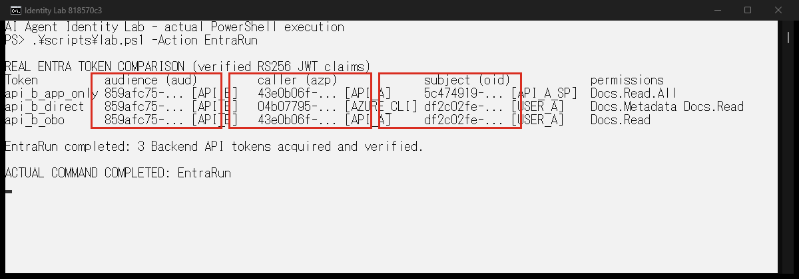
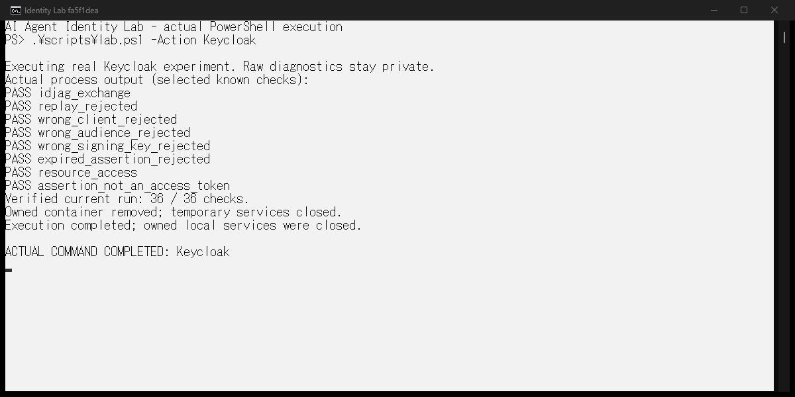
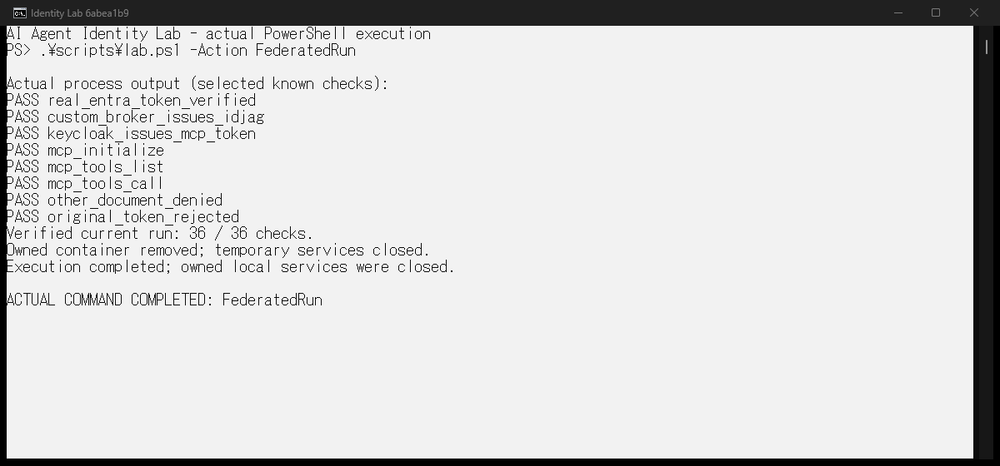
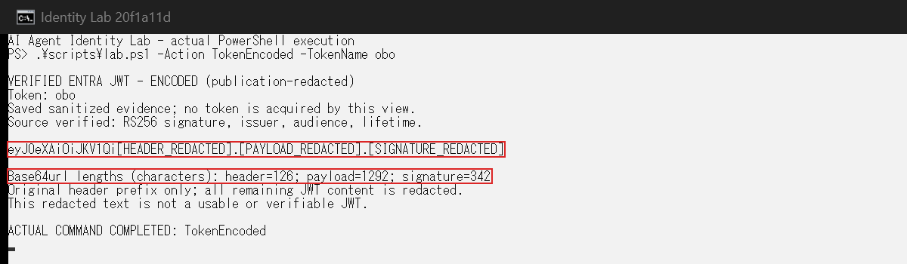
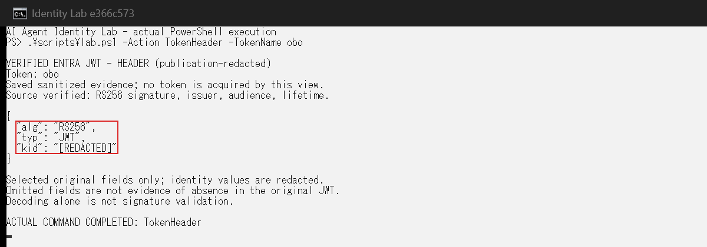
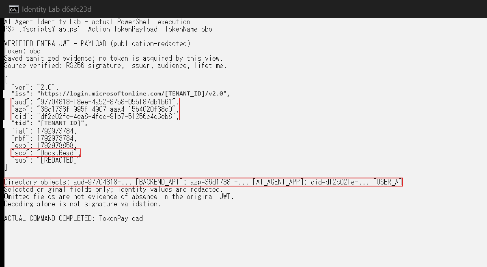
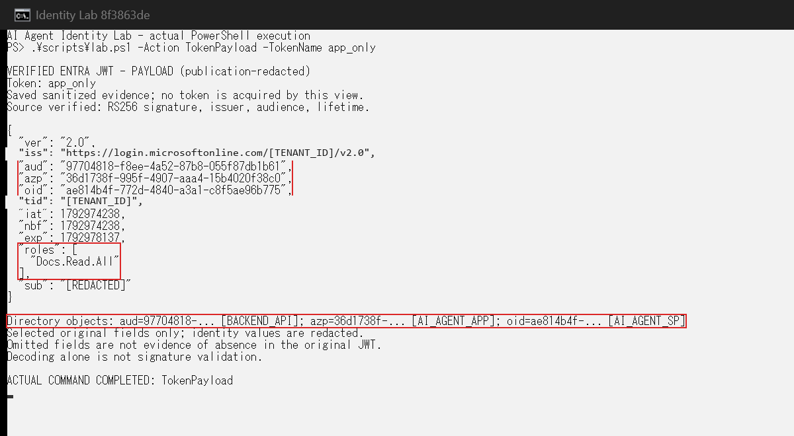
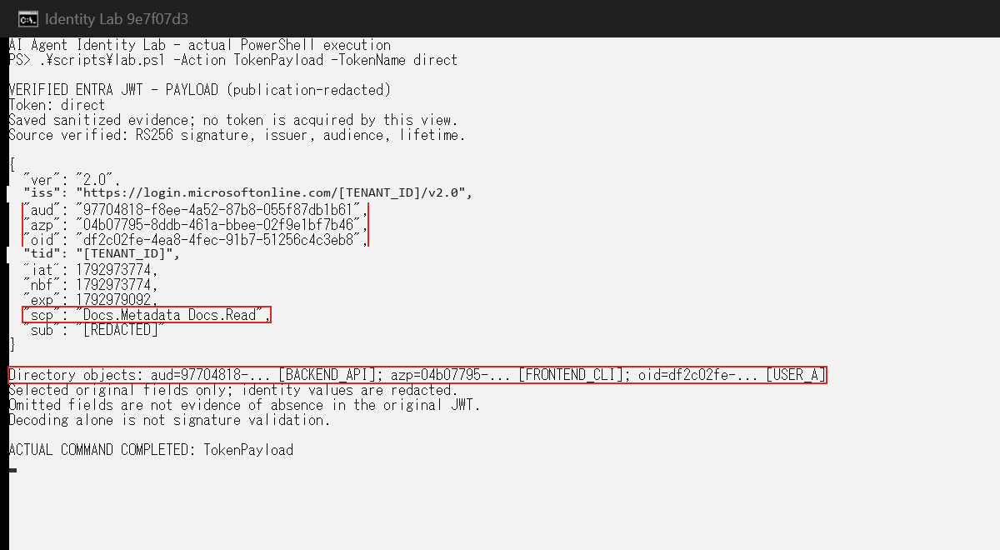

# AI Agent Identity Lab

Entra ID の On-Behalf-Of (OBO) と、Keycloak の実験的な ID-JAG 受信機を、独立した小さな実験で確かめるサンプルコードです。オプションの連携実験では、Entra の実ユーザートークン → **独自実装のローカル broker** → Keycloak → 読み取り専用の MCP ツールを通します。書籍原稿は含みません。

## 何が試せる？

| 実験 | 必要なもの | 何が分かるか |
| --- | --- | --- |
| Keycloak | Node.js・Docker | Entra なしで、実際の Keycloak ID-JAG 受信機と拒否ケースを検証 |
| Entra | 許可された Azure テナントと Azure CLI セッション | 新規の専用アプリを使い、委任・アプリ権限・実際の OBO トークンを比較 |
| Federated | 成功した自分の EntraRun と Keycloak の前提条件 | 独自 broker の ID-JAG 発行から MCP 呼び出しまでのプロトタイプを検証 |

**限界:** OBO は RFC 8693 の token exchange ではありません。この連携は Entra によるネイティブ ID-JAG 発行でも、Keycloak によるネイティブ ID-JAG 発行でも、安定版 MCP Enterprise-Managed Authorization (EMA) 仕様への完全準拠でもありません。Keycloak の受信機能は使用リリースにおいて実験的です。オフラインテストや過去のレポートを、自分のテナントでの成功証拠として扱わないでください。

## クイックスタート（Windows）

前提: スクリプトの実行を許可されたWindows PowerShell 5.1またはPowerShell 7、Node.js 22以上、Linuxコンテナーを使えるDocker Desktop。Python 3.11以上とAzure CLI v2はEntra実験で使います。Docker用ループバックポート **18080** を空けてください。イメージや依存関係の取得、Entraの実験にはインターネット接続が必要です。アプリ登録と同意に必要な権限は自分のテナント管理者と確認してください。組織の実行ポリシーを自動で回避する処理はありません。

書籍の再現用バージョンは `v1.2.1` です。段階別のアクション(`EntraPrepare`、`EntraAuthz`、`FederatedPrepare`、`FederatedRun`)を含み、Federated の各アクションが毎回新しい実験を実行するように修正した版です。既存の `v1.0.0`、`v1.1.0`、`v1.2.0` は変更していません。まずAzureを使わないKeycloak単独の実験を実行できます。

```powershell
git clone https://github.com/murasamelabo/ai-agent-identity-lab.git
Set-Location ai-agent-identity-lab
git checkout v1.2.1
.\scripts\lab.ps1 -Action Setup -SkipPython
.\scripts\lab.ps1 -Action Doctor
.\scripts\lab.ps1 -Action Test -SkipPython
.\scripts\lab.ps1 -Action Keycloak
```

`Setup` は固定digestのKeycloakイメージを取得します。`-SkipPython` を省略した場合は、ルートの `.venv` を作成してEntraの宣言済み依存関係も導入します。ログインもクラウド資源の変更も自動では行いません。`Doctor` はローカルの状態とAzure CLIセッションのマスクされた要約を読む診断で、ログインは行いません。CLIがなければKeycloak単独の利用に進めます。`Test` はオフラインの単体テストです。`Keycloak` は専用一時コンテナーを起動して統合テストを行います。結果を成功とみなせるのは、その実行が実際に完了した場合だけです。

### Entra を使う場合のみ：明示的に認証・実行

Azure CLI へのログインはランチャーの外で、権限を持つ本人が行います。**ログイン・トークン・テナント情報を含む画面を公開用キャプチャに残さないでください。** `EntraProbe` は Entra では読み取り専用ですが、保護されたローカル状態を作成します。`EntraRun` は毎回新しい実験を作るため、失敗時に安易に再実行しないでください。

```powershell
az login --tenant "<検証用テナントID>" --allow-no-subscriptions
.\scripts\lab.ps1 -Action Setup
.\scripts\lab.ps1 -Action EntraPrepare
.\scripts\lab.ps1 -Action EntraRun
.\scripts\lab.ps1 -Action EntraAuthz
.\scripts\lab.ps1 -Action FederatedPrepare
.\scripts\lab.ps1 -Action FederatedRun
.\scripts\lab.ps1 -Action Cleanup
```

`EntraPrepare` は専用の **2 アプリ登録と各サービスプリンシパル**、新規カスタムスコープへのユーザー単位の同意・アプリロール割り当て、**24 時間のシークレット**を作ります。シークレットは Windows の `%LOCALAPPDATA%` 配下の ACL 保護されたプライベート状態に保持し、リポジトリには入れません。現在の Azure CLI セッション、アプリ管理権限および必要な同意が要ります。テナントポリシー変更、既存アプリ変更、Microsoft Graph 権限の新規付与、MFA 回避はしません。`EntraRun` は `EntraPrepare` で準備した構成を使って 3 種類のトークンを取得・比較し、`EntraAuthz` は取得したトークンに対するローカルの認可判定を表示します。`FederatedPrepare` と `FederatedRun` は、どちらも Keycloak（Receiver）と独自 Issuer、MCP サーバーを一時的に起動して、ID-JAG の交換から MCP 呼び出しまでの実験を毎回新しく実行し、終了時に一時サービスを停止します。保存済みの結果を今回の実行として表示することはありません。`FederatedPrepare` は完了した実験で使った構成(信頼関係、ユーザーの対応付け、MCP サーバー)を、`FederatedRun` は交換と呼び出しの結果を表示します。**すべての Federated 実行が終わってから Cleanup** を行います。

`Report` は同じ実行の保護されたローカル状態で検証してから、マスク済みの実トークン比較を端末へ出力します。`examples/author-run/` は著者の過去の実行例であり、読者の実行結果ではありません。自分の出力先 `entra/reports/` と `keycloak/results/` はGitで無視します。レポートの伏字化やローカル整合性検証は、第三者による認証や安全性の証明ではありません。共有前に人間が内容を確認してください。

### JWTの文字列・ヘッダー・ペイロードを確認する

`v1.1.0` 以降の `EntraRun` は署名、発行者、宛先、有効期間を検証した後に、JWTの公開用抜粋を同じ `comparison.json` の `token_inspection` に記録します。完全なJWT、Base64urlのペイロード、署名、テナントID、ユーザーID、アプリID、ドメインは保存しません。この抜粋も既存のローカルHMACと観測ダイジェストに含めます。

自分の実行と `EntraAudit` が完了したら、リポジトリのルートで次を実行します。

```powershell
.\scripts\lab.ps1 -Action TokenEncoded -TokenName obo
.\scripts\lab.ps1 -Action TokenHeader -TokenName obo
.\scripts\lab.ps1 -Action TokenPayload -TokenName app_only
.\scripts\lab.ps1 -Action TokenPayload -TokenName direct
.\scripts\lab.ps1 -Action TokenPayload -TokenName obo
# 直近に成功した Keycloak または Federated の実行で、ID-JAGと交換後アクセストークンを比較する場合
.\scripts\lab.ps1 -Action TokenPayload -TokenName idjag
.\scripts\lab.ps1 -Action TokenPayload -TokenName keycloak_access_token
```

これらは取得済みの抜粋を検証・表示する操作で、追加のトークン取得やアプリ作成はありません。`TokenName` は `app_only`、`direct`、`obo`、`agent_input`、`metadata`（Entra用）と、`idjag`、`keycloak_access_token`（Keycloak用）から選びます。省略時は `obo` です。別のPythonを使う場合はEntra用の各行に `-Python $LabPython` を付けます。

- `TokenEncoded`：元のヘッダーの先頭が既知の定型16文字の場合だけ残し、残りのヘッダー・ペイロード全体・署名全体を伏せた3部分の形と、元の各部分の文字数。既知の先頭でない場合はヘッダーも全体を伏せます。**この表示は使用・署名検証できるJWTではありません。**
- `TokenHeader`：実機トークンから抽出した `alg`、存在する場合の `typ`、マスクした `kid`／`x5t`。
- `TokenPayload`：許可したクレームだけのJSON抜粋。ID・発行者・`sub` はマスクし、元の `iat`／`nbf`／`exp` と、存在する場合の文字列 `scp`／配列 `roles` を保ちます。抜粋外の項目が表示されないことから、元のJWTにも存在しないとは判断できません。**デコードと署名検証は別です。**

`v1.0.0` の結果には抜粋がないため、新しい実行の代わりに過去の結果を補完して表示しません。既存の実行を続ける場合は、取得上限が残っていることを確認して `EntraResume` を明示的に選びます。取得回数をリセットしたり、表示のたびに `EntraRun` を実行したりしないでください。

#### 生JWTを手元だけで表示するオプション

**録画、画面共有、ターミナルのログ／トランスクリプトを停止した、本人のローカル端末だけで使用してください。生JWTはBearer認証情報です。外部のJWTデコードサイト、チャット、Issue、書籍、Gitへ貼らないでください。Base64urlは暗号化ではなく、元のペイロードから識別情報を読み取れます。**

初回実行で生JWTも確認したい場合は、上の通常の `EntraRun` **の代わりに**次を選びます。両方を実行しないでください。

```powershell
.\scripts\lab.ps1 -Action EntraRun -ShowRawTokens
```

検証とレポート保存が成功した場合に限り、その取得で検証した完全なJWTをローカルコンソールへ表示します。保存済みの抜粋から生JWTを復元する機能ではありません。`-Screen`、公開画像用アクション、OS側の標準出力がリダイレクトされた環境では拒否します。生JWTはPowerShellの出力ストリームを経由せず、子Pythonが実際のコンソールへ直接書きます。パイプや変数への代入で取り出すための機能ではありません。Pythonを直接使う場合も `lab.py run --show-raw-tokens`／`resume --show-raw-tokens` は非リダイレクトのコンソールが必要です。この制限だけで画面録画を検知できるわけではありません。

### 直接実行

Windows PowerShellでランチャーを使わずに試す場合は、リポジトリのルートから次のコマンドを実行します。

```powershell
python -m venv .venv
.\.venv\Scripts\python.exe -m pip install -r entra\requirements.txt
Set-Location entra
..\.venv\Scripts\python.exe -m unittest -v
Set-Location ..
npm run check --prefix keycloak
npm run test:unit --prefix keycloak
Set-Location keycloak
node run.mjs
Set-Location ..
```

最後の `node run.mjs` だけはDockerを使用しますが、Azureは使いません。直接実行時の出力は詳細な診断用です。公開用の画面には、出力項目を制限するランチャーを使ってください。Entraの復旧・監査・片付けは [entra/README.md](entra/README.md)、Keycloakと連携の詳細は [keycloak/README.md](keycloak/README.md) と [keycloak/FEDERATED.md](keycloak/FEDERATED.md) を参照してください。

Windows ARM64では暗号ライブラリのwheelが利用できず、通常のpip導入が失敗することがあります。その場合は、宣言したバージョンの依存関係を既に備えたPythonを `-Python` で指定できます。著者の検証では、既存のAzure CLI同梱Pythonを使用しました。CLIへパッケージを追加したり、CLIキャッシュを読み取ったりする方法ではありません。

```powershell
$AzFolder = Split-Path (Get-Command az).Source -Parent
$LabPython = Join-Path (Split-Path $AzFolder -Parent) 'python.exe'
.\scripts\lab.ps1 -Action Setup -Python $LabPython
.\scripts\lab.ps1 -Action Test -Python $LabPython
.\scripts\lab.ps1 -Action EntraRun -Python $LabPython
```

この場合、`EntraAudit`、`EntraVerify`、`Report`、`Cleanup` にも同じ `-Python $LabPython` を付けます。Windows固有の保護ストレージを使うEntra実験はmacOS/Linux非対応です。macOS/LinuxではNode.jsとDockerによるKeycloakの直接実行だけが対象です。

## 実際の端末画面を撮影する

`capture-terminal.ps1` は新しいWindowsネイティブコンソールで実際にコマンドを実行し、そのウィンドウの画素を取得します。HTMLで端末を模した画像を作ったり、古いログを成功したように再生したりしません。実行したコマンドと完了表示が画面に含まれます。

```powershell
.\scripts\capture-terminal.ps1 -Action Keycloak
.\scripts\capture-terminal.ps1 -Action Federated
.\scripts\capture-terminal.ps1 -Action Report
# 別のPythonを使う場合
.\scripts\capture-terminal.ps1 -Action Report -Python $LabPython
# 取得済みJWTのマスク済み表示だけを撮影
.\scripts\capture-terminal.ps1 -Action TokenEncoded -TokenName api_b_obo -Python $LabPython
.\scripts\capture-terminal.ps1 -Action TokenHeader -TokenName api_b_obo -Python $LabPython
.\scripts\capture-terminal.ps1 -Action TokenPayload -TokenName api_b_obo -Python $LabPython
.\scripts\capture-terminal.ps1 -Action TokenPayload -TokenName api_b_app_only -Python $LabPython
.\scripts\capture-terminal.ps1 -Action TokenPayload -TokenName api_b_direct -Python $LabPython
.\scripts\capture-terminal.ps1 -Action TokenPayload -TokenName idjag
.\scripts\capture-terminal.ps1 -Action TokenPayload -TokenName keycloak_access_token
```

`Keycloak` と `Federated` はこの撮影でも実際に再実行されます。`Report` は取得済みの実測結果を検証して表示する操作で、新たなトークン取得ではありません。対話可能なWindowsデスクトップが必要です。画像は既定で `artifacts/screenshots/` に保存し、書籍用には `-OutputDirectory` で指定します。
`TokenEncoded`／`TokenHeader`／`TokenPayload` も取得済みのマスク済み実測を表示します。ファイル名にはトークン名を含め、3種類のペイロードを上書きせず撮影できます。キャプチャには生JWTを表示するオプションはありません。

実際の診断出力はメモリー内で受け取り、許可した検査名・応答・別名だけを端末へ出します。未知の出力、コマンド失敗、所有者を確認できないウィンドウ、空の画像では成功画像を保存しません。撮影後は、完了表示、可読性、伏字を目視で確認してください。`docs/screenshots/` は著者が実際に撮影した画面です。
JWTの掲載画像は可読性のため、撮影した画素からウィンドウ枠と空白の余白だけを切り取っています。文字の再描画や結果の差し替えはしていません。新しい実測のマスク済みJSONは [examples/author-run/jwt-inspection-comparison.json](examples/author-run/jwt-inspection-comparison.json) です。
撮影時は読みやすいように主な8件を短い検査名で表示します。36件すべての成否を検証した上での抜粋であり、未表示の検査を省略実行するわけではありません。

`-TimeoutSeconds` は画像の採用期限です。期限を超えても検証処理を強制終了せず、コンテナーなどの片付けが完了するまで待って画像を不採用にします。途中で強制停止した場合は、個別の復旧手順に従って所有する検証資材だけを確認してください。

Dockerによる作成後に所有確認ができなかった場合、公開用ランチャーは生の診断を表示せず、完全なコンテナーIDと期待する所有nonceだけを `artifacts/recovery/` に残します。ここはGit管理対象外です。記録を非公開で確認し、実際のラベルとIDが一致するまで削除しないでください。未知のコンテナーを自動で引き取る機能ではありません。

### 著者の実際の端末画面

以下は、このリポジトリのコマンドを実行したネイティブコンソールの撮影結果です。
Reportは取得済みのEntra実測の検証・表示、残り二つは撮影時に実験を再実行しています。
読者の実行結果ではありません。







JWT追加検証の実際の端末画面です。元のJWTをそのまま公開した画像ではありません。











## リポジトリ

- `entra/lab.py`, `entra/report_safety.py`, `entra/lab-manifest.json`, `entra/requirements.txt`：Entra実験と報告の検証。
- `keycloak/run.mjs`, `keycloak/federated-mcp.mjs`, `keycloak/package.json`：Keycloak単独／オプション連携。既定のループバックポートは18080。
- `entra/test_*.py`, `keycloak/*.test.mjs`：65件のPythonと10件のNodeオフラインテスト。受信機／連携の各36件の統合チェックには実サービスが必要です。
- `examples/author-run/`：著者の実行例。自分の成功の証拠ではありません。

## AI支援ツールを使う場合

[AGENTS.md](AGENTS.md) に構成、安全上の制約、確認方法をまとめています。
クラウド変更やCleanupを実行する前に、対象と操作範囲を本人が確認してください。

## ライセンスと参加

リポジトリ内の**オリジナルのサンプルコードのみ** MIT License（© 2026 murasamelabo）。[LICENSE](LICENSE) を参照。書籍原稿は含まず、外部依存ソフトウェアには各提供元のライセンスが適用されます。参加方法は [CONTRIBUTING.md](CONTRIBUTING.md)、脆弱性報告は [SECURITY.md](SECURITY.md) を参照してください。
