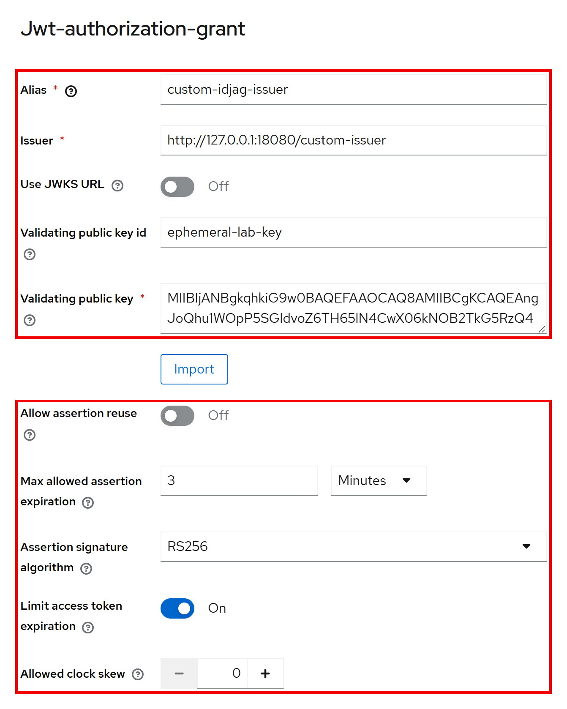
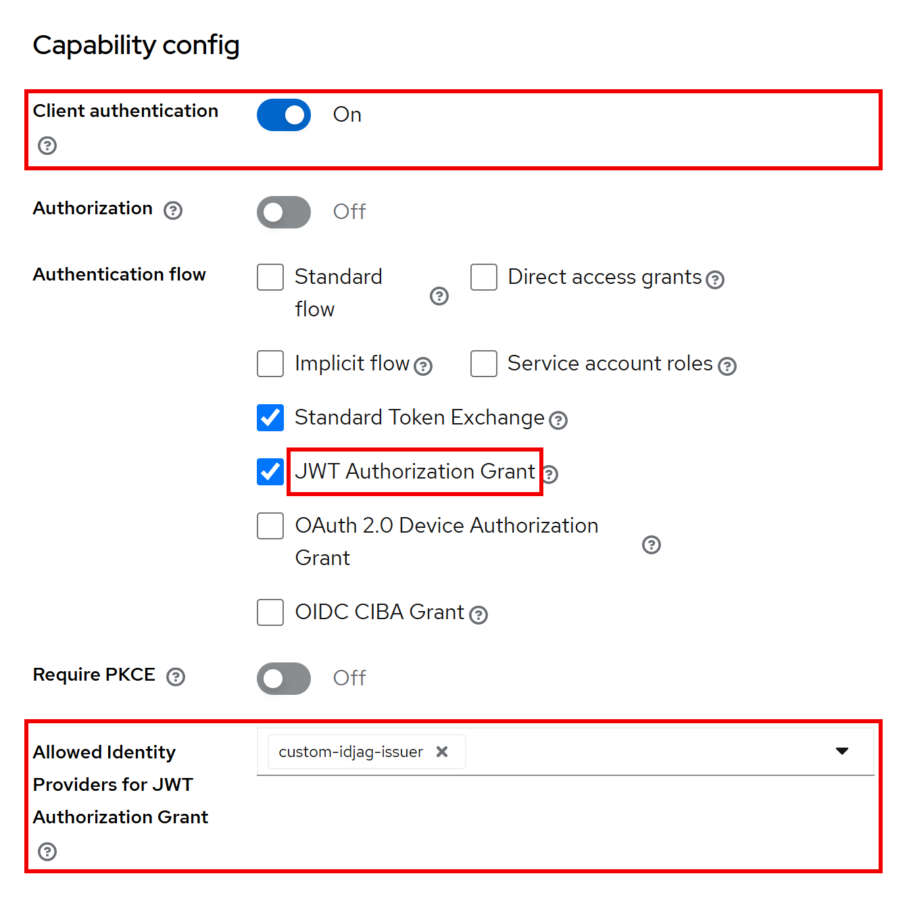
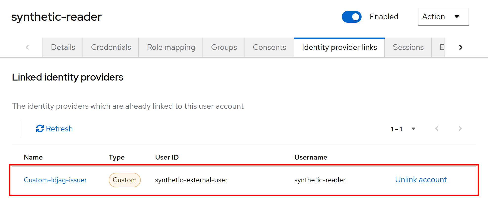

# 検証パターン一覧(EntraAuthz・Federated・Keycloak)

書籍の第 6 章は、トークンの各クレームの中身を確認する検証(`EntraRun`、`TokenPayload`、`FederatedRun` など)に絞っています。この文書は、許可と拒否のパターンを一件ずつ確かめる三つのアクション、`EntraAuthz`、`Federated`、`Keycloak` が何を確かめ、結果をどう読むかをまとめたものです。表の番号は、各アクションの画面に出る番号(`01`、`02`、…)と同じです。

| アクション | 件数 | 必要なもの | 確かめること |
| --- | --- | --- | --- |
| `EntraAuthz` | 9 | 成功した `EntraRun`(手元で完結) | 取得した Entra のトークンを、Backend API 役の認可関数に渡したときの許可と拒否 |
| `Federated` | 36 | 成功した `EntraRun`、Docker | 自作 Issuer と MCP サーバーが、不正な要求を拒否すること |
| `Keycloak` | 44 | Docker(Entra は不要) | Receiver の Keycloak が、条件を崩した ID-JAG トークンを拒否すること |

`Federated` と `Keycloak` は、実行のたびに Keycloak の Docker コンテナーを一時的に起動し、終了時に停止・削除します。Cleanup は、すべての `Federated` 実行が終わってから行います。

## 画面の読み方

- `now` は要求を送った時刻です。`[valid: x]` は、有効な要求での値です。`[required: x]` は、リソース側が要求する値です。`sha256:` は署名を含むトークン全体の指紋で、同じ指紋は同じトークンです。
- 拒否された件でも、応答のエラー名だけでは原因が分からないことがあります。原因は、サーバー側のログ(`reason`)に残ります。ログのイベントのエラー名(`invalid_request` など)と、応答のエラー名(`invalid_grant` など)が違う場合があります。
- 各件は、有効な要求から条件を一つだけ崩して送り、期待した結果と一致したことを確かめます。全件が一致しない限り、成功とは表示されません。

## EntraAuthz(9 件)

取得した Entra のトークンを、Backend API 役のローカルの認可関数に渡します。サンプル文書(Alice と Bob)に対する判定で、Web API は立てません。認可関数は、次の順序で判定します。

1. トークン自体の検証：署名(RS256)、発行者(`iss`)、テナント(`tid`)、宛先(`aud` が Backend API であること)、トークンのバージョン(`ver` が `2.0`)、有効期限(`exp`・`iat`・`nbf`)。
2. ユーザー委任の経路：必要な委任 scope(`Docs.Read` または `Docs.Metadata`)が含まれていること。そのうえで、トークンの `oid` と対象文書の所有者を照合します。
3. アプリケーション権限の経路：委任トークンではないこと(サンプルでは `scp` クレームがないこと)、アプリケーションロール `Docs.Read.All` を持つこと、許可した呼び出し元アプリ(`azp`)であること。

| 番号 | 条件 | 結果 |
| --- | --- | --- |
| 1 | 直接委任(`direct`)で Alice の文書を読む | 許可(`allow`) |
| 2 | 直接委任で Bob の文書を読む | 所有者不一致で拒否(`wrong_owner`) |
| 3 | OBO(`obo`)で Alice の文書を読む | 許可(`allow`) |
| 4 | OBO で Bob の文書を読む | 所有者不一致で拒否(`wrong_owner`) |
| 5 | クライアントクレデンシャル(`app_only`)で、アプリ経路から Alice の文書を読む | 許可(`allow`) |
| 6 | クライアントクレデンシャルで、アプリ経路から Bob の文書を読む | 許可(`allow`) |
| 7 | クライアントクレデンシャルで、ユーザー委任の経路を呼ぶ | 委任 scope がないため拒否(`missing_scope`) |
| 8 | `Docs.Read` だけの OBO トークンで、`Docs.Metadata` が必要な経路を呼ぶ | 拒否(`missing_scope`) |
| 9 | AI Agent App 宛てのトークン(`agent_input`)を Backend API に提示する | 宛先の不一致で拒否(`rejected_wrong_audience`) |

- 1 から 4：ユーザー本人に対応する文書は許可され、別ユーザーの文書は、ツールの引数を変えても読めません。直接委任と OBO のどちらでも同じです。
- 5 から 7：アプリ自身の権限(`Docs.Read.All`)は、アプリ権限用の経路でだけ使えます。ユーザーになりすまして、委任の経路を通ることはできません。
- 本番の API では、省略可能クレーム `idtyp` が `app` であることの確認も推奨されます。ユーザーに割り当てたアプリロールも委任トークンの `roles` に入るため、`roles` の有無だけでは、アプリ自身のトークンか委任トークンかを区別できません。

## Federated(36 件)

実際の Entra のトークンを起点に、自作の Issuer、Keycloak(Receiver)、最小の MCP サーバーへ、不正な要求を一件ずつ送ります。区分 `[A]` から `[G]` の順に画面へ表示されます。

### [A] Entra のサインイントークン(01-03)

| 番号 | 条件 | 結果 |
| --- | --- | --- |
| 01 | 署名(Entra の鍵)、`iss`、`aud`、`exp`、`tid`、`oid`、`azp`、`scp` を検証する | 受理(`ok`) |
| 02 | 同じトークンで、期待する宛先を別の API(Backend API)にする | 拒否(`WrongAudience`) |
| 03 | 同じトークンで、トークンにない scope を期待する | 拒否(`MissingEntraUserScope`) |

### [B] メタデータと、トークンのない要求(04-07)

| 番号 | 条件 | 結果 |
| --- | --- | --- |
| 04 | `Authorization` ヘッダーのない MCP 要求 | `HTTP 401 invalid_token`。MCP サーバーのログは `MissingBearer` |
| 05 | MCP サーバーの保護リソースメタデータ | `HTTP 200` |
| 06 | 自作 Issuer のメタデータ | `HTTP 200`。`authorization_grant_profiles_supported` はない |
| 07 | Keycloak のメタデータ | `HTTP 200`。`authorization_grant_profiles_supported` はない(ID-JAG のプロファイルを載せていない) |

### [C] 自作 Issuer の交換：Entra のトークン → ID-JAG トークン(08-14)

Issuer が受け付けるのは、`audience` が Keycloak の Realm、`resource` が MCP サーバーの URL、`scope` が `mcp.read`、`client_id` が `mcp-ema-client`(と正しいシークレット)、そして未使用で有効な Entra のトークンです。

| 番号 | 条件 | 結果 |
| --- | --- | --- |
| 08 | `audience` を Realm の URL + `/wrong` にする | `HTTP 400 invalid_target`。ログは `audience is not the registered Receiver` |
| 09 | `resource` を MCP の URL + `/wrong` にする | `HTTP 400 invalid_target`。ログは `resource is not the registered MCP server` |
| 10 | `scope` を `mcp.admin` にする | `HTTP 400 invalid_scope` |
| 11 | `client_secret` を誤った値にする(トークンは有効) | `HTTP 401 invalid_client` |
| 12 | `subject_token` を `not-a-token` にする | `HTTP 400 invalid_grant`。ログは `InvalidJwt` |
| 13 | 正しい要求 | `HTTP 200`。ID-JAG トークンを返す(`typ` は `oauth-id-jag+jwt`、`aud` は Realm、`resource` は MCP、有効期間は 120 秒) |
| 14 | 同じ Entra のトークンをもう一度提示する | `HTTP 400 invalid_grant`。ログは `subject_token was already used` |

14 の「交換元のトークンは一回しか使えない」は、この自作 Issuer 独自のポリシーで、ID-JAG の仕様が求めるものではありません。

### [D] Keycloak の jwt-bearer グラント：ID-JAG トークン → アクセストークン(15-18)

| 番号 | 条件 | 結果 |
| --- | --- | --- |
| 15 | 13 の ID-JAG トークンを提示する | `HTTP 200`。アクセストークンを返す(`typ` は `JWT`、`iss` は Realm、`aud` は MCP サーバー、`azp` は `mcp-ema-client`) |
| 16 | 同じ ID-JAG トークンをもう一度提示する | `HTTP 400 invalid_grant`。ログは `Token reuse detected` |
| 17 | 15 のアクセストークンを、`aud` を MCP の URL + `/wrong` として検証する(手元の検証) | 拒否(`WrongAudience`) |
| 18 | 15 のアクセストークンを、`scope` を `mcp.admin` として検証する(手元の検証) | 拒否(`MissingMcpScope`) |

### [E] MCP サーバーが受け付けない Bearer(19-22)

MCP サーバーが Bearer を受け入れる条件は、`kid` が Keycloak の Realm の鍵(JWKS)にあり、署名が正しく、`iss` が Realm、`azp` が `mcp-ema-client`、`aud` が MCP の URL、`scope` に `mcp.read` を含み、`exp` が未来であることです。

| 番号 | 条件 | 結果 |
| --- | --- | --- |
| 19 | Bearer に、元の Entra のトークンを提示する | `HTTP 401 invalid_token`。ログは `UnknownSigningKey` |
| 20 | Bearer に、ID-JAG トークンを提示する | `HTTP 401 invalid_token`。ログは `UnknownSigningKey`(`kid` の `ephemeral-lab-key` は Keycloak の鍵にない) |
| 21 | 15 のアクセストークンの署名の先頭 1 文字だけを変えて提示する | `HTTP 401 invalid_token`。ログは `InvalidJwtSignature` |
| 22 | 有効な Bearer で、`Origin` を `https://untrusted.invalid` にする | `HTTP 403 invalid_origin` |

19 から 21 は、応答がどれも同じ `HTTP 401 invalid_token` です。拒否の理由を区別できるのは、サーバーのログだけです。

### [F] MCP のプロトコル手順(23-34)

| 番号 | 条件 | 結果 |
| --- | --- | --- |
| 23 | `initialize` の前に `tools/list` | `HTTP 400`(`MCP-Session-Id` がない) |
| 24 | `initialize` | `HTTP 200`(セッションを作成) |
| 25 | `notifications/initialized` の前に `tools/list` | `HTTP 400` |
| 26 | `notifications/initialized` | `HTTP 202` |
| 27 | `MCP-Protocol-Version` を `2099-01-01` にする | `HTTP 400` |
| 28 | `tools/list` | `HTTP 200` |
| 29 | `tools/call`(`documentId=alice`) | `HTTP 200`。検証ユーザー自身の文書 |
| 30 | `tools/call`(`documentId=bob`) | `HTTP 200` だが、ツールの結果が `isError=true`(他のユーザーの文書は読めない) |
| 31 | 想定外の引数を付けた `tools/call` | `HTTP 200` と JSON-RPC エラー `-32602` |
| 32 | GET(任意の SSE ストリーム) | `HTTP 405` |
| 33 | DELETE(セッションの終了) | `HTTP 204` |
| 34 | 終了したセッションで `tools/list` | `HTTP 404` |

30 の拒否は、HTTP のエラーではありません。Bearer は有効なので HTTP の層では成功し、文書を読む権限がないことは、ツールの結果で表します。

### [G] コンテナーの所有確認(35-36)

Docker で作成したコンテナーを、完全な ID と実行ごとの nonce で確認してから削除することの確認です。名前が衝突しても、既存のコンテナーには手を付けません。

### 返るエラーの読み方

- 08 と 09 の `invalid_target` は、ID-JAG の仕様が IdP に定めるエラーと一致します。10 の `invalid_scope` と 11 の `invalid_client` は、OAuth の一般のエラーです。
- 12 の `invalid_grant` は、仕様が IdP に定める `invalid_request` とは異なる、この自作 Issuer の実装です。
- 16 の Keycloak の `invalid_grant` は、仕様がリソース側に定めるエラーにあたります。ただし、ログのイベントの `error` は `invalid_request` で、応答の `invalid_grant` とは名前が違います。

## Keycloak(44 件)

Entra のテナントも自作の Issuer も使いません。Docker で Keycloak 26.8.1 を一時的に起動し、スクリプトが使い捨ての RSA 鍵で署名した ID-JAG トークンを、条件を一つずつ崩しながら送ります。実物なのは Receiver の Keycloak だけです。

### Receiver の設定

この検証で Keycloak に構成する設定です。管理コンソールの画面は、`keycloak/run.mjs` と同じ設定を、管理コンソールを開ける状態で起動した Keycloak 26.8.1 に構成して撮影しました。`lab.ps1` が起動するコンテナーは、管理者のパスワードを表示せず、実行の終わりに削除されるので、そのままでは管理コンソールを開けません。

- Identity Provider(`custom-idjag-issuer`)：種類は JWT Authorization Grant。`Issuer` に ID-JAG トークンの `iss` と一致する値、`Validating public key` にテスト用の鍵を設定します。再利用は許可せず(`Allow assertion reuse` が Off)、有効期限の上限(`jwtAuthorizationGrantMaxAllowedAssertionExpiration`)は 180 秒、署名方式は `RS256`、許容する時刻のずれは 0 です。`Limit access token expiration`(`jwtAuthorizationGrantLimitAccessTokenExp`)は On で、アクセストークンの期限は ID-JAG トークンの期限を超えません。
- クライアント(`receiver-client`)：クライアント認証を有効にした機密クライアントで、JWT Authorization Grant を許可し、利用できる Identity Provider を `custom-idjag-issuer` に限ります。
- ユーザー(`synthetic-reader`)：Identity Provider(`custom-idjag-issuer`)側の利用者 ID `synthetic-external-user` を連携します。ID-JAG トークンの `sub` がこの値と一致すると、Keycloak はこのローカルユーザーとしてアクセストークンを発行します。
- Realm のアクセストークンの有効期間は 120 秒です。

180 秒の設定は、`iat` が古すぎる ID-JAG トークン(18)と、使用済みトークンの記録を保持する期間に効きます。`exp` と `iat` の差(有効期間)の上限ではありません(30)。

### [A] 正しい ID-JAG トークン(01-03)

| 番号 | 条件 | 結果 |
| --- | --- | --- |
| 01 | 正しい ID-JAG トークンを提示する | `HTTP 200`。アクセストークンの `sub` は連携したローカルユーザー、`aud` は `lab-api` と `account`、`azp` は `receiver-client`、期限は ID-JAG トークンと同じ 120 秒 |
| 02 | 応答に `refresh_token` がない | `ok`。ID-JAG の仕様も、リソース側の認可サーバーは更新トークンを返さないことを推奨しています(§4.4.4) |
| 03 | アクセストークンを Realm の公開鍵(JWKS)で検証する | `ok`。署名、`iss`、`azp`、`sub`、`aud`、`scope`、`exp` を確認 |

### [B] ID-JAG トークンの条件を一つずつ崩す(04-18)

どの件も応答は `HTTP 400 invalid_grant` です。原因は、Keycloak のログの `reason` と、01 のトークンとの差(`[valid: ...]`)で分かります。

| 番号 | 条件 | Keycloak のログの理由(`reason`) |
| --- | --- | --- |
| 04 | 同じ ID-JAG トークンの再送(同じ `jti`) | `Token reuse detected` |
| 05 | `client_id` を別のクライアント(`another-client`)にする | `client id in assertion : another-client and client id in request header/body : receiver-client` |
| 06 | `client_id` を省く | 05 と同じ形(アサーション側が `null`) |
| 07 | `iat` を省く | `Token iat claim is required` |
| 08 | `jti` を省く | `Token jti claim is required` |
| 09 | `exp` を省く | `Token exp claim is required` |
| 10 | `aud` を別の Realm にする | `Invalid token audience` |
| 11 | `aud` を複数にする | `Multiple audiences not allowed` |
| 12 | `iss` を登録のない発行者にする | `No Identity Provider for provided issuer` |
| 13 | `sub` を連携していない値にする | `User not found` |
| 14 | 登録した鍵と別の RSA 鍵で署名する(クレームは同じ) | `Invalid signature` |
| 15 | 期限切れにする(`iat` を `now-120s`、`exp` を `now-60s`) | `Token is not active` |
| 16 | 未来の `nbf`(`now+60s`)を付ける | `Token is not active` |
| 17 | `iat` を未来(`now+60s`)にする | `Token was issued in the future` |
| 18 | `iat` を古すぎる値(`now-240s`)にする | `Token was issued too far in the past to be used now` |

ID-JAG トークンは、要求したクライアントに結び付いています(05、06。§4.4.1)。`aud` は、別の認可サーバーへの使い回しを防ぎます(10。§9.4)。

### [C] クライアントの認証と設定、利用者の対応付け(19-26)

| 番号 | 条件 | 結果 |
| --- | --- | --- |
| 19 | `client_secret` を誤った値にする | `HTTP 401 unauthorized_client`。`error_description` は `Invalid client or Invalid client credentials`、ログのイベントの `error` は `invalid_client_credentials` |
| 20 | JWT Authorization Grant を許可していないクライアント(`grant-disabled-client`) | `HTTP 400 invalid_grant`。`JWT Authorization Grant is not supported for the requested client` |
| 21 | この Identity Provider を許可していないクライアント(`idp-not-allowed-client`) | `HTTP 400 invalid_grant`。`Identity Provider is not allowed for the client` |
| 22 | `client_secret` を送らない | `HTTP 401 unauthorized_client`(19 と同じ) |
| 23 | 公開クライアント(`public-lab-client`。クライアント認証なし) | `HTTP 400 invalid_grant`。`Public client not allowed to use authorization grant` |
| 24 | 23 と同じ設定の機密クライアント(`confidential-control-client`。対照) | `HTTP 200` |
| 25 | 連携していない `sub` に、連携済みユーザーと同じ `email` を付ける | `HTTP 400 invalid_grant`。`User not found`(13 と同じ) |
| 26 | 25 の前後でローカルユーザーの数を数える | `ok`(1 のまま変わらない) |

- 25 と 26：この構成では、メールアドレスで利用者を探すことも、新しく作ることもありません。事前に登録した連携(Identity Provider と `sub` の組)で、ローカルユーザーを特定します(§9.8、§10)。
- 23 と 24：拒否の理由はクライアントの種類にあります。

### [D] `typ` による検証の選択と、有効期間(27-32)

| 番号 | 条件 | 結果 |
| --- | --- | --- |
| 27 | `typ` を `JWT` にし、`client_id` と `iat` を省く | `HTTP 200`(受理) |
| 28 | `typ` を `JWT` にし、`client_id` を別のクライアントにする | `HTTP 200`(受理) |
| 29 | `typ` を `not-idjag+jwt` にし、`client_id` と `iat` を省く | `HTTP 200`(受理) |
| 30 | `exp` を `now+600s` にする(`iat` あり) | `HTTP 200`。アクセストークンの期限は 120 秒 |
| 31 | `typ` を `JWT` にし、`iat` を省いて `exp` を `now+600s` にする | `HTTP 400 invalid_grant`。`Token expiration is too far in the future and iat claim not present in token` |
| 32 | `exp` を `now+30s` にする | `HTTP 200`。アクセストークンの期限は ID-JAG トークンと同じ時刻 |

- 27 から 29：Keycloak 26.8.1 は、`typ` が `oauth-id-jag+jwt` のときだけ ID-JAG 向けの検証(クライアントとの結び付き、`iat` の必須など)を行い、それ以外は RFC 7523 の汎用の検証に回します。ID-JAG の仕様は `typ` の確認を求めている(§4.4.1)ので、この版では、ID-JAG 向けの検証を通らない JWT も、汎用の検証で受け付けられます。信頼する IdP、署名鍵、クライアントの許可を絞り、IdP 側でも交換元の種類を確認することが前提です。
- 30：180 秒の設定が見るのは `iat` の古さ(18)で、`exp` と `iat` の差の上限ではないため、有効期間の長い ID-JAG トークンも受理されます。ID-JAG トークンの有効期間を短く保つ責任は、発行する IdP にあります。

### [E] イントロスペクション、トークン交換、リソースサーバー(33-42)

リソースサーバーが Bearer を受け入れる条件は、`kid` が Realm の鍵(JWKS)にあり、署名が正しく、`iss` が Realm、`azp` が `receiver-client`、`aud` に `lab-api` を含み、`scope` に `lab.read` を含み、`exp` が未来であることです。

| 番号 | 条件 | 結果 |
| --- | --- | --- |
| 33 | `receiver-client`(`aud` に含まれない)がイントロスペクションする | `HTTP 200`、`active=false`。`Client 'receiver-client' is not in the token audience` |
| 34 | `lab-api`(`aud` に含まれる)がイントロスペクションする | `HTTP 200`、`active=true` |
| 35 | アクセストークンを RFC 8693 で交換する(対照) | `HTTP 200` |
| 36 | RFC 8693 の交換で ID-JAG トークンを要求する | `HTTP 400 invalid_request`。`requested_token_type unsupported`(26.8.1 は ID-JAG の Issuer に未対応) |
| 37 | Bearer に Keycloak のアクセストークンを提示する | `HTTP 200`(受理) |
| 38 | Bearer に ID-JAG トークンを提示する | `HTTP 401 invalid_token`。ログは `UnknownSigningKey` |
| 39 | `Authorization` ヘッダーを付けない | `HTTP 401 invalid_token`。ログは `MissingBearer` |
| 40 | 有効期限 6 秒の ID-JAG トークンから発行したアクセストークンを、すぐに提示する | `HTTP 200`(受理) |
| 41 | 40 と同じトークンを、8 秒後に提示する | `HTTP 401 invalid_token`。ログは `ExpiredJwt` |
| 42 | アクセストークンを、別の API(`another-api`)向けとして検証する(手元の検証) | 拒否(`WrongAudience`) |

- 33 と 34：`active=false` は、署名したトークンが一般に無効だという意味ではありません。調べた側が宛先に含まれていない、という判定です。
- 40 と 41：このリソースサーバーは、署名と期限などをその場で検証するだけで、発行後に IdP の状態を確かめません。API が署名と期限だけを確かめる構成では、発行済みのアクセストークンは期限まで通ります。IdP で利用者を無効にしても、すでに発行されたアクセストークンをすぐに止められるとは限りません。

### [F] コンテナーの所有確認(43-44)

名前が衝突しても既存のコンテナーを残すこと(43)と、後片付けで検証済みのコンテナー ID だけを削除すること(44)の確認です。

### 返るエラーの読み方

ID-JAG の仕様が定めるエラー名と違う箇所があります。製品を選ぶときは、返ってくるエラー名だけで原因を判断せず、実際の挙動とログを確かめます。

- 13 と 25：仕様は、ID-JAG トークン自体は有効でも利用者の登録(プロビジョニング)がない場合などに、相互運用のためのエラーとして `access_denied` を示しています(§4.4.3)。Keycloak 26.8.1 は `invalid_grant` で拒否しました。
- 19 と 22：クライアント認証の失敗を、仕様の `invalid_client` ではなく `unauthorized_client` で返します。
- 23：公開クライアントを、仕様の `invalid_client`(§4.4、§9.1)ではなく `invalid_grant` で拒否します。
- 04 から 18 などの ID-JAG トークンの検証の失敗：応答は `invalid_grant` で、ログのイベントの `error` は `invalid_request` です。Keycloak の公式ガイドが対象とする ID-JAG は改訂 01 で、こうした差の背景にあると考えられます。

## 件数と画面を更新するとき

チェックを追加・変更したら、この一覧の番号と件数、`README.md` と `keycloak/README.md`、`keycloak/FEDERATED.md` の件数も更新します。画面の番号は、チェックの実行順に付きます。
